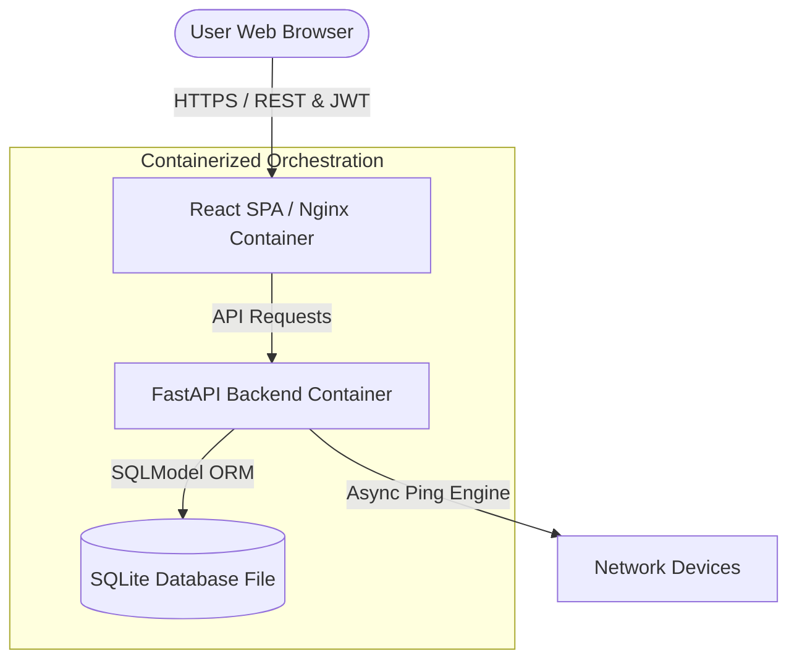

# DCmapper 🖥️📍

DCmapper is a lightweight, responsive, full-stack web application designed for mapping physical datacenter locations, managing rack coordinates, inventorying hardware down to individual U-slots, and tracking live device statuses with an asynchronous background ping engine.

The system is fully containerized using **Docker** and **Docker Compose**, featuring a fast **FastAPI** backend with SQLite persistence and a modern **React SPA** frontend.

---

## 🛠️ Architecture & Tech Stack



### Stack Highlights
*   **Backend:** Python 3.11, **FastAPI** (asynchronous runtime), **SQLModel** (SQLAlchemy + Pydantic integration) for the database schema.
*   **Frontend:** React, TypeScript, Tailwind CSS, built via **Vite** and served by **Nginx**.
*   **Database:** **SQLite** with an asynchronous SQLite driver (`aiosqlite`), persisted via Docker volumes.
*   **Monitoring:** Background worker executing concurrent ICMP ping queries via `asyncio`.

---

## ✨ Core Features

1.  **Multi-Site Dashboard:** A bird's-eye view card list of all configured locations capturing physical addresses, contact records, and general description notes.
2.  **Interactive Floor Grid:** A 2D coordinate system ($X \times Y$) for placing rack enclosures onto exact coordinates. Includes movement boundary checks and cabinet overlap validation.
3.  **Rack "U" Elevation View:** Vertical schematic representing individual slots (up to 42U or custom heights). Shows accurate sizing, hardware models, and live status lights.
4.  **Device Inventory:** Track hostname, device type (Server, Switch, PDU, Patch Panel), hardware vendor, IP addresses, installation dates, and out-of-band management endpoints (with external dashboard quick-links).
5.  **Live Ping Monitor:** An automated background service that scans all devices with active IPs, issues concurrent ICMP pings, records histories, and notifies the UI in near real-time.
6.  **Soft-Deletion & Archiving:** Pruned resources are placed into archives and kept for a configurable retention window before being permanently destroyed.

---

## 🚀 Quick Start (Docker Compose)

### Prerequisites
*   [Docker](https://docs.docker.com/get-docker/)
*   [Docker Compose](https://docs.docker.com/compose/install/)

### Deploying the Application
Launch both services using Docker Compose from the root directory:

```bash
docker compose up -d --build
```

The stack starts the following services:
*   **React Frontend:** [http://localhost:3000](http://localhost:3000)
*   **FastAPI backend:** [http://localhost:8000](http://localhost:8000)
*   **API Interactive Documentation (Swagger):** [http://localhost:8000/docs](http://localhost:8000/docs)

> [!IMPORTANT]
> The backend container requires ICMP raw socket permissions to execute ping requests. This is handled automatically by adding the `NET_RAW` capability in `docker-compose.yml`.

### Default Credentials
*   **Admin:** `username: admin` | `password: admin` (Full write privileges)
*   **Viewer:** `username: viewer` | `password: viewer` (Read-only access)

---

## 📖 Backend API Reference

All requests to the backend APIs require token-based authentication using an **OAuth2 Bearer JWT** token, except for the login endpoint. Pass the token via the `Authorization` header: `Authorization: Bearer <token>`.

### Endpoint Summary

| Category | HTTP Method | Path | Access Role | Description |
| :--- | :--- | :--- | :--- | :--- |
| **Auth** | `POST` | `/token` | Public | Authenticate user and obtain access token |
| | `GET` | `/users/me/` | Viewer / Admin | Retrieve current user profile |
| | `PATCH` | `/users/me/password` | Viewer / Admin | Update own user password |
| | `GET` | `/users/` | Admin | List all registered users |
| | `POST` | `/users/` | Admin | Register a new user |
| | `DELETE` | `/users/{user_id}` | Admin | Delete a user (cannot delete self) |
| **Datacenters** | `GET` | `/datacenters/` | Viewer / Admin | List all datacenter sites |
| | `POST` | `/datacenters/` | Admin | Create a new datacenter site |
| | `GET` | `/datacenters/{dc_id}` | Viewer / Admin | Retrieve site layout & nested racks |
| | `PATCH` | `/datacenters/{dc_id}` | Admin | Update site detail / resize floor layout |
| | `DELETE` | `/datacenters/{dc_id}` | Admin | Cascade delete a datacenter and contents |
| | `GET` | `/datacenters/{dc_id}/export` | Viewer / Admin | Export all devices in site to CSV |
| **Racks** | `GET` | `/racks/` | Viewer / Admin | List all rack enclosures |
| | `POST` | `/racks/` | Admin | Place a new rack onto coordinate grid |
| | `GET` | `/racks/{rack_id}` | Viewer / Admin | Retrieve rack slot elevation (active devices) |
| | `PATCH` | `/racks/{rack_id}` | Admin | Shift coordinates / resize rack slots |
| | `DELETE` | `/racks/{rack_id}` | Admin | Permanently delete rack and housed units |
| **Devices** | `POST` | `/devices/` | Admin | Mount a device into a rack U-slot |
| | `GET` | `/devices/{device_id}` | Viewer / Admin | Retrieve device details |
| | `PATCH` | `/devices/{device_id}` | Admin | Update specs or change U-slot mounting |
| | `GET` | `/devices/{device_id}/history` | Viewer / Admin | Get health monitoring logs for device |
| | `DELETE` | `/devices/{device_id}` | Admin | Soft-delete equipment (sent to archives) |
| **Config** | `GET` | `/config/` | Viewer / Admin | Get background loop interval / retention |
| | `PATCH` | `/config/` | Admin | Edit background timings / retention days |
| **Device Fields** | `GET` | `/device-fields/` | Viewer / Admin | List all device attributes/fields configuration |
| | `POST` | `/device-fields/` | Admin | Create a completely new custom field |
| | `PATCH` | `/device-fields/{field_id}` | Admin | Update field label, type, required status, or toggle active/inactive |
| | `DELETE` | `/device-fields/{field_id}` | Admin | Delete custom field (or deactivate built-in field) |

---

## 🔒 Relational Logic & Constraints

The API protects infrastructure mapping integrity using strict transactional and layout check assertions before executing databases writes:

*   **Floor Grid Resizing Check:** You cannot shrink the dimensions (`width` or `height`) of a datacenter if there are any configured racks located on coordinates outside the new boundaries.
*   **Rack Overlap Check:** Relocating or creating a rack on grid coords already occupied by another cabinet is rejected.
*   **Rack Boundary Check:** Cabinets cannot be placed outside the dimensions of the parent datacenter.
*   **Cabinet Shrinkage Check:** Lowering the total U-slots of a rack is blocked if there are active equipment mounted in the slots being trimmed.
*   **U-Slot Collisions:** Registering or moving devices to slots already occupied by active equipment inside the target rack will return a conflict error.
