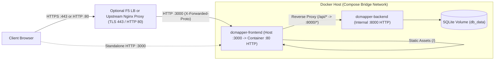

# Reusable Plain-HTTP Frontend and Internal-Only Backend Compose Architecture

*   **Author:** Gemini CLI
*   **Status:** Draft
*   **Date:** 2026-11-15

--------------------------------------------------------------------------------

## Overview

DCmapper is a containerized web application consisting of a React single-page application served by Nginx (`dcmapper-frontend`) and a FastAPI + SQLite backend (`dcmapper-backend`). This design refactors the container build and Docker Compose configuration so `dcmapper-frontend` serves plain HTTP on container port 80 (mapped to host port `3000` in the base compose file) and `dcmapper-backend` keeps port `8000` internal to the Docker network. This allows the same container image and base compose setup to run standalone over HTTP, behind an F5 load balancer that terminates TLS and forwards traffic to host port `3000`, or behind an upstream Nginx reverse proxy.

## The Problem

The current deployment configuration in `docker-compose.yml`, `frontend/Dockerfile`, and `frontend/nginx.conf` couples DCmapper to a single network topology:

1.  **Unconditional HTTPS Redirect and Build-Time Self-Signed Certificate:** `frontend/Dockerfile` installs OpenSSL and generates a self-signed certificate for `CN=localhost` during image build. `frontend/nginx.conf` redirects all port 80 requests (`301`) to `https://` and terminates TLS on port 443. When an external F5 load balancer or upstream Nginx reverse proxy terminates TLS and forwards plain HTTP to the container, requests enter an infinite `301` redirect loop unless the upstream proxy re-encrypts traffic to container port 443 and disables certificate verification.
2.  **Exposed Backend Port Bypassing the Frontend Proxy:** `docker-compose.yml` publishes port `8000` on `dcmapper-backend` directly to the host network instead of isolating the backend behind the `dcmapper-frontend` reverse proxy.
3.  **Unbounded Import Payloads vs. Proxy Body Limits and Swagger UI Breakage:** Routing all traffic exclusively through `dcmapper-frontend` subjects bulk CSV imports to Nginx's 1 MB request body limit, which returns an HTML `413 Request Entity Too Large` page instead of a structured validation message. Furthermore, removing host port `8000` breaks direct access to Swagger UI unless the backend is configured to serve OpenAPI documentation under the `/api` reverse-proxy prefix.

The proposed solution strips OpenSSL and port 443 TLS termination from `dcmapper-frontend`, serves the React SPA and `/api/` reverse proxy on container port 80 (published on host port `3000`), isolates `dcmapper-backend` port `8000` inside the Docker network, configures the backend root path so `/api/docs` works through the proxy, and enforces a `< 1 MB` bulk CSV import limit across the UI, Nginx, and backend API.

## Goals

*   Serve the React SPA (`/`) and backend reverse proxy (`/api/`) over plain HTTP on container port `80` in `frontend/nginx.conf`, mapped to host port `3000` in `docker-compose.yml`.
*   Remove OpenSSL installation, build-time self-signed certificate generation, and port `443` exposure from `frontend/Dockerfile`.
*   Keep `dcmapper-backend` port `8000` internal to the Docker network in the base `docker-compose.yml`.
*   Preserve upstream forwarded protocol headers in `frontend/nginx.conf` when behind an F5 load balancer or Nginx reverse proxy, falling back to the local request scheme in standalone HTTP mode.
*   Keep interactive OpenAPI documentation reachable at `/api/docs` through the frontend proxy when running under Docker Compose.
*   Enforce a maximum file size of `< 1 MB` on bulk CSV imports across the frontend UI, Nginx proxy, and backend import analysis endpoint.

## Non-Goals

*   Supporting subpath deployments (such as hosting DCmapper under `/dcmapper/` instead of `/`).
*   Terminating TLS or managing ACME/Let's Encrypt certificates inside the `dcmapper-frontend` container.
*   Modifying SQLite database schemas, authentication tokens, or role-based access control rules.

## Open Questions

*   None. All deployment mode, port mapping, upload size, and API documentation questions were resolved during brainstorming.

## Critical User Journeys (CUJs)

### CUJ 1: Standalone or F5/Nginx-Proxied Application Access on Port 3000

*   **Given**: The DCmapper stack is started with Docker Compose, binding `dcmapper-frontend` to host port `3000` -> container port `80` and keeping `dcmapper-backend` internal on port `8000`.
*   **When**: A user accesses DCmapper either directly at `http://<host>:3000/` or via an F5 load balancer / upstream Nginx reverse proxy that terminates TLS on port 443 and forwards plain HTTP to `<host>:3000`.
*   **Then**: `dcmapper-frontend` serves the React SPA on HTTP `200` without issuing a `301` redirect to HTTPS, proxies `/api/*` requests to `http://backend:8000/*` while preserving the upstream forwarded protocol header, and serves interactive OpenAPI documentation at `/api/docs`.

### CUJ 2: Bulk CSV Import Size Validation Under 1 MB

*   **Given**: An authenticated admin opens the Bulk Import Wizard in the floor grid view for a datacenter.
*   **When**: The admin selects a CSV file whose size is `1 MB` or larger, or a client submits an oversized payload directly to the import analysis endpoint.
*   **Then**: The UI rejects the file immediately in the browser with a validation error before uploading, the Nginx proxy enforces a 1 MB request body cap at the ingress boundary, and the backend import analysis endpoint rejects payloads of `1 MB` or larger with HTTP `400`.

## Technical Plan (Architecture)

### System Topology & Data Flow

The refactored architecture establishes `dcmapper-frontend` (port 80 inside the container, mapped to host port `3000`) as the sole external ingress point for the Docker Compose stack. `dcmapper-backend` listens on port `8000` exclusively on the internal Docker bridge network.

### Component Changes

1.  **Frontend Container Image (`frontend/Dockerfile`):**
    *   Retain the two-stage build (`node:20-slim` build stage compiling the React + TypeScript bundle, followed by `nginx:stable-alpine` runtime stage).
    *   Remove the OpenSSL installation step and `/etc/nginx/ssl` self-signed certificate generation so the image contains only static assets and Nginx configuration.
    *   Expose only port `80`, removing port `443`.
2.  **Frontend Nginx Reverse Proxy (`frontend/nginx.conf`):**
    *   Remove the port 80 `301` HTTPS redirect block and the port `443 ssl` server block.
    *   Define a single `server` block listening on port `80` with a 1 MB request body limit (`client_max_body_size 1m;`).
    *   Map `$http_x_forwarded_proto` so `X-Forwarded-Proto` preserves the upstream proxy's scheme (`https` when terminated at F5 or upstream Nginx) and falls back to `$scheme` (`http`) when accessed directly in standalone mode.
    *   Route `/` to the static React SPA and proxy `/api/` to `http://backend:8000/`.
3.  **Docker Compose Orchestration (`docker-compose.yml`):**
    *   On `backend`: Remove host port `8000:8000` publishing so the backend is reachable only over the internal Docker network, and add environment variable `ROOT_PATH=/api`.
    *   On `frontend`: Map host port `3000` to container port `80` (`"3000:80"`). Environment-specific port or network changes can be layered using standard Docker Compose override files without modifying the base file.
4.  **Backend Reverse-Proxy Root Path & Import Size Check (`backend/app/main.py`):**
    *   Configure the FastAPI application instance with `root_path` read from the `ROOT_PATH` environment variable (defaulting to empty string when unset). When `ROOT_PATH=/api` is set in Docker Compose, requests proxied from `/api/docs` to `/docs` generate OpenAPI schema URLs pointing to `/api/openapi.json`, keeping Swagger UI functional through the Nginx proxy.
    *   In the bulk CSV import analysis endpoint, enforce a `< 1 MB` limit on the uploaded file content and return HTTP `400` if exceeded.
5.  **Frontend Bulk Import Pre-Upload Check (`frontend/src/components/GridView.tsx`):**
    *   In the CSV file selection handler for the Bulk Import Wizard, check the selected file size before calling the import analysis API. If the file is `1 MB` or larger, set an error state informing the user that the CSV file must be smaller than 1 MB and skip the network upload.

## Alternatives Considered

### Alternative A: Bind Host Port 80 (`"80:80"`) in Base `docker-compose.yml`

*   **Pros**: Allows standalone users to omit `:3000` in browser URLs (`http://<host>/`).
*   **Cons**: Conflicts with any upstream Nginx reverse proxy running on the same Docker host that already binds ports 80 and 443. Furthermore, because Docker Compose merges `ports:` arrays across override files rather than replacing them, overriding `"80:80"` requires special YAML tags or environment variable indirection.
*   **Reason for Rejection**: Rejected by author: keeping host port `3000` (`"3000:80"`) avoids privileged port conflicts when co-located with an Nginx reverse proxy on ports 80/443 while still supporting F5 pool forwarding and standalone access on port `3000`.

### Alternative B: Raise Nginx `client_max_body_size` Above 1 MB for Bulk Imports

*   **Pros**: Permits multi-megabyte CSV uploads without modifying frontend or backend validation logic.
*   **Cons**: Increases memory consumption in `backend/app/main.py`, which reads the entire uploaded CSV file into memory and parses all rows synchronously within a single request.
*   **Reason for Rejection**: Rejected by author: datacenter rack/device CSV imports fit well within 1 MB, and enforcing a `< 1 MB` cap across the UI, Nginx, and backend bounds memory usage and provides immediate validation feedback.

### Alternative C: Runtime Environment Variable TLS Mode Switching Inside the Container

*   **Pros**: Allows a single container to toggle between plain HTTP and self-signed/mounted HTTPS via entrypoint template scripts.
*   **Cons**: Retains OpenSSL and entrypoint scripting complexity inside `dcmapper-frontend` for TLS termination that is already handled upstream by F5 or Nginx.
*   **Reason for Rejection**: Rejected by author: serving plain HTTP inside the container (with Docker Compose overrides for environment-specific topology) eliminates certificate management inside the application container.

### Alternative D: Subpath Reverse-Proxy Support (e.g., `/dcmapper/`)

*   **Pros**: Allows multiple applications to share a single hostname without subdomains.
*   **Cons**: Requires dynamic base path injection into Vite build assets, React Router `basename`, and Axios `baseURL`.
*   **Reason for Rejection**: Rejected by author: all target deployments (standalone, F5 load balancer, and Nginx reverse proxy) host DCmapper at the root path (`/`).

### Alternative E: Continue Publishing Backend Port `8000:8000` on the Host by Default

*   **Pros**: Allows direct host access to `http://localhost:8000/docs` without configuring FastAPI `root_path`.
*   **Cons**: Exposes the Uvicorn server directly on the host network, bypassing the frontend Nginx reverse proxy and its request limits.
*   **Reason for Rejection**: Rejected by author: keeping port `8000` internal to the Docker network enforces a single ingress boundary through `dcmapper-frontend`, while `ROOT_PATH=/api` keeps Swagger UI accessible at `/api/docs`.

--------------------------------------------------------------------------------

## Non-Functional Requirements

*   **Security & Privacy**:
    *   **Transport Security in Standalone vs. Proxied Mode**: Because `dcmapper-frontend` serves plain HTTP on port `3000`, standalone deployments transmit OAuth2 password credentials and Bearer JWTs in cleartext unless placed behind an F5 load balancer or TLS-terminating Nginx reverse proxy. Production deployments must terminate TLS upstream on port 443.
    *   **Internal Backend Isolation**: Removing `8000:8000` from `docker-compose.yml` reduces the host attack surface by preventing direct external access to the Uvicorn process.
*   **Performance & Latency**:
    *   Removing `apk add --no-cache openssl` and RSA-2048 key generation from `frontend/Dockerfile` reduces container build time and image size.
    *   Rejecting CSV files `>= 1 MB` in the browser before upload avoids unnecessary network transfer and bounds backend memory allocation during CSV parsing.
*   **Rollout & Rollback**:
    *   **Rollout**: Update the F5 pool (or upstream Nginx `proxy_pass`) to forward plain HTTP to host port `3000`, then run `docker compose up -d --build`.
    *   **Rollback**: Revert the commit and run `docker compose up -d --build` (restoring `3000:443` HTTPS and `8000:8000`).

--------------------------------------------------------------------------------

## Detailed Implementation Plan

### Execution Phases & Checkpoints

*   **Phase 1 (Backend & Frontend Application Validation):** Update `./backend/app/main.py` and `./frontend/src/components/GridView.tsx` to add `ROOT_PATH` OpenAPI support and the `< 1,048,576` byte CSV import limit. Verify that the frontend compiles and lints (`cd frontend && npm run build && npm run lint`).
*   **Phase 2 (Container & Compose Refactor):** Update `./frontend/Dockerfile`, `./frontend/nginx.conf`, and `./docker-compose.yml` to switch `dcmapper-frontend` to plain HTTP on port 80 (mapped to host port `3000`) and isolate `dcmapper-backend` port `8000` internally.
*   **Phase 3 (Blueprint & Component Contract Sync):** Update `./README.md`, `./frontend/README.md`, `./backend/app/README.md`, and `./frontend/src/components/README.md` so all EGM contracts match the updated ports, proxy headers, and import limits.

### Target Files to Create/Modify

#### 1. `./backend/app/main.py` (Modify)

*   **Type / Scope**: Python FastAPI Service
*   **Rationale**: Enable Swagger UI (`/api/docs`) to resolve `/api/openapi.json` when served behind the frontend Nginx reverse proxy without breaking direct non-Docker execution, and enforce the `< 1 MB` (`1,048,576` bytes) CSV import size limit on the server side.
*   **Proposed Changes**:
    *   Import `os` in the top-level standard library imports (around lines 7–9).
    *   Define module-level constant `MAX_IMPORT_FILE_BYTES = 1048576` (`1 MB`).
    *   At line 28, update the FastAPI initialization from `app = FastAPI(title="DCmapper API")` to pass `root_path=os.getenv("ROOT_PATH", "")`.
    *   In `analyze_import` (`POST /datacenters/{dc_id}/import/analyze`, around line 333), read up to `MAX_IMPORT_FILE_BYTES` bytes (`await file.read(MAX_IMPORT_FILE_BYTES)`). If `len(content) >= MAX_IMPORT_FILE_BYTES`, raise `HTTPException(status_code=400, detail="Import file exceeds the 1 MB size limit.")` before decoding or parsing CSV rows.

#### 2. `./frontend/src/components/GridView.tsx` (Modify)

*   **Type / Scope**: TypeScript React Component
*   **Rationale**: Reject CSV files `>= 1 MB` (`1,048,576` bytes) immediately in the browser during file selection so the user receives a structured validation message in the Import Wizard modal instead of an Nginx `413 Request Entity Too Large` error.
*   **Proposed Changes**:
    *   Define constant `MAX_IMPORT_FILE_BYTES = 1048576` above `GridView` (or inside `handleImportFileChange` at line 35).
    *   In `handleImportFileChange` (lines 35–61), after extracting `const file = e.target.files[0];` and resetting `importAnalysis`, `importError`, and `importSuccess`, check if `file.size >= MAX_IMPORT_FILE_BYTES`.
    *   When `file.size >= MAX_IMPORT_FILE_BYTES`, set `setImportError("Import file exceeds the 1 MB size limit. Please select a file smaller than 1 MB.")`, do not call `analyzeImport`, and return early.

#### 3. `./frontend/Dockerfile` (Modify)

*   **Type / Scope**: Container Build Configuration
*   **Rationale**: Remove build-time OpenSSL installation, self-signed TLS certificate generation, and port 443 exposure since `dcmapper-frontend` now serves plain HTTP on port 80.
*   **Proposed Changes**:
    *   Delete lines 14–20 (`RUN apk add --no-cache openssl && mkdir -p /etc/nginx/ssl && openssl req ...`).
    *   Delete line 26 (`EXPOSE 443`), keeping only `EXPOSE 80` before `CMD ["nginx", "-g", "daemon off;"]`.

#### 4. `./frontend/nginx.conf` (Modify)

*   **Type / Scope**: Nginx Reverse Proxy Configuration
*   **Rationale**: Replace the port 80 HTTPS redirect and port 443 SSL server blocks with a single port 80 HTTP server block that enforces a 1 MB request body cap and preserves upstream `X-Forwarded-Proto` headers from F5 or upstream Nginx proxies.
*   **Proposed Changes**:
    *   At the top of `./frontend/nginx.conf` (outside the `server` block, which is included inside Nginx's `http` context via `/etc/nginx/conf.d/default.conf`), add a `map` block mapping `$http_x_forwarded_proto` to `$forwarded_proto`:
        *   `default` -> `$http_x_forwarded_proto`
        *   `""` -> `$scheme`
    *   Replace the two existing `server` blocks (lines 1–36) with a single `server` block:
        *   Listen on port `80` (`listen 80;`, `server_name localhost;`).
        *   Set `client_max_body_size 1m;`.
        *   Retain `location /` serving `/usr/share/nginx/html` with `index index.html index.htm;` and `try_files $uri $uri/ /index.html;`.
        *   Retain `location /api/` with `proxy_pass http://backend:8000/;`, `proxy_set_header Host $host;`, `proxy_set_header X-Real-IP $remote_addr;`, `proxy_set_header X-Forwarded-For $proxy_add_x_forwarded_for;`, and update `proxy_set_header X-Forwarded-Proto` to use `$forwarded_proto;`.
        *   Retain `error_page 500 502 503 504 /50x.html;` and `location = /50x.html`.

#### 5. `./docker-compose.yml` (Modify)

*   **Type / Scope**: Docker Compose Orchestration Manifest
*   **Rationale**: Isolate `dcmapper-backend` on the internal Docker network, configure `ROOT_PATH=/api` for proxied Swagger UI support, and map host port `3000` to container port `80` on `dcmapper-frontend`.
*   **Proposed Changes**:
    *   Under `services.backend.environment` (lines 10–11), add `- ROOT_PATH=/api` alongside `- DATABASE_URL=sqlite:///./data/dcmapper.db`.
    *   Under `services.backend`, remove the `ports:` section (`- "8000:8000"`, lines 14–15) so port `8000` is not published to the host.
    *   Under `services.frontend.ports` (lines 21–23), replace `- "3000:443"` and the commented `# - "8008:8008"` line with `- "3000:80"`.

#### 6. `./README.md` (Modify)

*   **Type / Scope**: Repository Root Blueprint Contract ([`./README.md`](./README.md))
*   **Rationale**: Keep the root architectural blueprint, Mermaid diagram, quick-start URLs, invariants, and side effects synchronized with the plain-HTTP port `3000 -> 80` frontend and internal-only backend.
*   **Proposed Changes**:
    *   In `## System Overview` (line 6), update `dcmapper-frontend` description from `on HTTPS port 3000 -> 443` to `on HTTP port 3000 -> 80 (with dcmapper-backend isolated on internal port 8000)`.
    *   In `## Subdirectories & System Boundaries` (line 11), update `frontend` summary from `Nginx TLS reverse-proxy container` to `Nginx HTTP reverse-proxy container`.
    *   In `## Global Invariants`, add the `< 1 MB` (`1,048,576` bytes) bulk CSV import size invariant enforced across `GridView.tsx`, `frontend/nginx.conf`, and `backend/app/main.py`.
    *   In `## Global Side Effects` (line 28), update the reverse-proxy description to state that `frontend/nginx.conf` listens on HTTP port 80 (mapped to host port `3000`), preserves `X-Forwarded-Proto`, enforces `client_max_body_size 1m;`, and proxies `/api/` traffic to internal `http://backend:8000/`.
    *   In `## 🛠️ Architecture & Tech Stack` (line 39), update the Mermaid edge label from `HTTPS / REST & JWT` to `HTTP (or Upstream TLS Proxy) / REST & JWT`.
    *   In `## 🚀 Quick Start (Docker Compose)` (lines 92–94), update the service URLs to:
        *   React Frontend: `http://localhost:3000` (plain HTTP; can be placed behind an F5 load balancer or Nginx TLS reverse proxy)
        *   API Interactive Documentation (Swagger): `http://localhost:3000/api/docs` (proxied through the frontend container; backend port `8000` is internal to the Docker network)

#### 7. `./frontend/README.md` (Modify)

*   **Type / Scope**: Component Package Contract ([`./frontend/README.md`](./frontend/README.md))
*   **Rationale**: Update the frontend package contract to reflect removal of OpenSSL/port 443 and addition of the single port 80 listener, `X-Forwarded-Proto` mapping, and `1m` body limit.
*   **Proposed Changes**:
    *   Update `## Overview` to state that `frontend` is packaged into an Nginx HTTP container on port 80 that serves the bundled static assets and reverse-proxies `/api/` requests to the internal FastAPI backend.
    *   In `## Interface`, replace `[nginx.conf:listen 80]` redirect and `[nginx.conf:listen 443 ssl]` entries with `[nginx.conf:map $http_x_forwarded_proto $forwarded_proto]` and `[nginx.conf:listen 80]` serving `/` and reverse-proxying `/api/` to `http://backend:8000/`; remove `[Dockerfile:EXPOSE 443]`.
    *   In `## Invariants`, replace the TLS protocol and port 80 redirect entries with `[nginx.conf:client_max_body_size]` (`1m` request body cap) and `[nginx.conf:$forwarded_proto]` (upstream `X-Forwarded-Proto` preservation with `$scheme` fallback).
    *   In `## Side Effects`, remove the `[Dockerfile:RUN openssl req]` entry.

#### 8. `./backend/app/README.md` (Modify)

*   **Type / Scope**: Component Package Contract ([`./backend/app/README.md`](./backend/app/README.md))
*   **Rationale**: Document `ROOT_PATH` configuration on `[main.py:app]` and the `< 1 MB` file size invariant on `[main.py:analyze_import]`.
*   **Proposed Changes**:
    *   In `## Interface`, update `[main.py:app]` to note `root_path=os.getenv("ROOT_PATH", "")` and add `[main.py:MAX_IMPORT_FILE_BYTES]` (`1048576`).
    *   In `## Invariants`, update `[main.py:analyze_import]` to state that it rejects uploaded files with size `>= 1,048,576` bytes (`1 MB`) with HTTP `400`.

#### 9. `./frontend/src/components/README.md` (Modify)

*   **Type / Scope**: Component Package Contract ([`./frontend/src/components/README.md`](./frontend/src/components/README.md))
*   **Rationale**: Document the client-side `< 1 MB` (`1,048,576` bytes) CSV import validation invariant in `GridView.tsx`.
*   **Proposed Changes**:
    *   In `## Invariants`, add an entry for `[GridView.tsx:handleImportFileChange]` stating that files with `file.size >= 1048576` (`1 MB`) are rejected in the browser with an `importError` message without invoking `analyzeImport`.

### Verification Plan

*   **Compilation/Build**:
    *   Run `cd frontend && npm run build` (`tsc -b && vite build`) and verify exit code `0`.
    *   Run `python3 -m py_compile backend/app/main.py` and verify exit code `0`.
*   **Static Analysis & Linting**:
    *   Run `cd frontend && npm run lint` (`eslint .`) and verify exit code `0` with zero warnings or errors.
*   **Unit & Behavioral Verification**:
    *   Verify `backend/app/main.py` `root_path` & `< 1 MB` import check:
        *   With `ROOT_PATH=/api`, verify `app.root_path == "/api"`.
        *   Call `analyze_import` with a mock/in-memory `UploadFile` of `1,048,576` bytes and assert it raises `HTTPException` with `status_code == 400` and `detail == "Import file exceeds the 1 MB size limit."`.
        *   Call `analyze_import` with a valid 2-row CSV under `1,048,576` bytes and assert `valid == True`.
*   **Container & Nginx Configuration Verification**:
    *   Verify `frontend/Dockerfile` contains no `openssl` or `443` references and exposes only port `80`.
    *   Verify `docker-compose.yml` maps `"3000:80"` on `frontend`, sets `ROOT_PATH=/api` on `backend`, and does not contain `ports:` under `backend`.

--------------------------------------------------------------------------------

<!-- Provenance: Indicates initial structural drafting via EGM. -->

*Drafted with EGM*
